# Библиотека оригиналов: кот и всё, что сгенерировано

Картинок: **117**, 221 МБ. Оригиналы — `originals/` байт в байт, как пришли из модели (PNG без пересжатия); `thumbs/` — превью для этой страницы; `catalog.json` — промпт, модель, цена, где используется.

Пополняется сама: каждая генерация через шлюз (`llm_gateway.Gateway.image`) кладёт картинку сюда, включая забракованные варианты. Собрать уже лежащее в репозитории: `python scripts/cat_library.py --scan`.

## генерация (71)

| превью | оригинал | где | промпт |
|---|---|---|---|
|  | [2026-10-25_gen_cx_gpt-image-2_1462d865.png](originals/2026-10-25_gen_cx_gpt-image-2_1462d865.png) 1531×1027, 2026-10-25 | `videos/05_ustal/reel/gen/u4_envelope_on_back.png` | Image 1 is a finished frame of an animation. Draw the very next key frame of the same shot: exactly the same camera angle, framing, scale, room, bed or floor, background, colors, line work, paper and lighting as image 1,… |
|  | [2026-10-25_gen_cx_gpt-image-2_2e233aa5.png](originals/2026-10-25_gen_cx_gpt-image-2_2e233aa5.png) 1531×1027, 2026-10-25 | `videos/04_noch/reel/gen/n6_phone_fell.png` | Image 1 is a finished frame of an animation. Draw the very next key frame of the same shot: exactly the same camera angle, framing, scale, room, bed or floor, background, colors, line work, paper and lighting as image 1,… |
|  | [2026-10-25_gen_cx_gpt-image-2_3210e6c7.png](originals/2026-10-25_gen_cx_gpt-image-2_3210e6c7.png) 1536×1024, 2026-10-25 | `videos/03_lenivyi/reel/gen/g3_together.png` `videos/L01_potom/frames/049.png` | Reference images 1-3 show only the drawing style: take from them the line work, colors, shading and simplicity, never their content or characters. Reference image 4 is the main character: keep exactly its head, face, col… |
|  | [2026-10-25_gen_cx_gpt-image-2_44ec48da.png](originals/2026-10-25_gen_cx_gpt-image-2_44ec48da.png) 1024×1536, 2026-10-25 | `videos/06_zaodno/reel/gen/d2_repot.png` | Reference images 1-3 show only the drawing style: take from them the line work, colors, shading and simplicity, never their content or characters. Reference image 4 is the main character: keep exactly its head, face, col… |
|  | [2026-10-25_gen_cx_gpt-image-2_46c1a36e.png](originals/2026-10-25_gen_cx_gpt-image-2_46c1a36e.png) 1024×1536, 2026-10-25 | `videos/06_zaodno/reel/gen/d6_done.png` | Reference images 1-3 show only the drawing style: take from them the line work, colors, shading and simplicity, never their content or characters. Reference image 4 is the main character: keep exactly its head, face, col… |
|  | [2026-10-25_gen_cx_gpt-image-2_53e40c7b.png](originals/2026-10-25_gen_cx_gpt-image-2_53e40c7b.png) 1531×1027, 2026-10-25 | `videos/05_ustal/reel/gen/u5_drained.png` | Reference images 1-3 show only the drawing style: take from them the line work, colors, shading and simplicity, never their content or characters. Reference image 4 is the main character: keep exactly its head, face, col… |
|  | [2026-10-25_gen_cx_gpt-image-2_834f59a5.png](originals/2026-10-25_gen_cx_gpt-image-2_834f59a5.png) 1024×1536, 2026-10-25 | `videos/06_zaodno/reel/gen/d3_movie.png` | Reference images 1-3 show only the drawing style: take from them the line work, colors, shading and simplicity, never their content or characters. Reference image 4 is the main character: keep exactly its head, face, col… |
|  | [2026-10-25_gen_cx_gpt-image-2_943d023c.png](originals/2026-10-25_gen_cx_gpt-image-2_943d023c.png) 1024×1536, 2026-10-25 | `videos/06_zaodno/reel/gen/d4_lost.png` | Reference images 1-3 show only the drawing style: take from them the line work, colors, shading and simplicity, never their content or characters. Reference image 4 is the main character: keep exactly its head, face, col… |
|  | [2026-10-25_gen_cx_gpt-image-2_a3ebc9f2.png](originals/2026-10-25_gen_cx_gpt-image-2_a3ebc9f2.png) 1024×1536, 2026-10-25 | `videos/06_zaodno/reel/gen/d5_note.png` | Reference images 1-3 show only the drawing style: take from them the line work, colors, shading and simplicity, never their content or characters. Reference image 4 is the main character: keep exactly its head, face, col… |
|  | [2026-10-25_gen_cx_gpt-image-2_ab8bccad.png](originals/2026-10-25_gen_cx_gpt-image-2_ab8bccad.png) 1024×1536, 2026-10-25 | `videos/06_zaodno/reel/gen/d1_mop.png` | Reference images 1-3 show only the drawing style: take from them the line work, colors, shading and simplicity, never their content or characters. Reference image 4 is the main character: keep exactly its head, face, col… |
|  | [2026-10-25_gen_cx_gpt-image-2_f140ef8b.png](originals/2026-10-25_gen_cx_gpt-image-2_f140ef8b.png) 1254×1254, 2026-10-25 | `videos/04_noch/reel/gen/n7_promise.png` | Reference images 1-3 show only the drawing style: take from them the line work, colors, shading and simplicity, never their content or characters. Reference image 4 is the main character: keep exactly its head, face, col… |
|  | [2026-10-26_gen_cx_gpt-image-2_1b9d6f2a.png](originals/2026-10-26_gen_cx_gpt-image-2_1b9d6f2a.png) 1024×1536, 2026-10-26 | `videos/09_napishi/reel/gen/m2_back.png` | Reference images 1-3 show only the drawing style: take from them the line work, colors, shading and simplicity, never their content or characters. Reference image 4 is the main character: keep exactly its head, face, col… |
|  | [2026-10-26_gen_cx_gpt-image-2_4e7b9837.png](originals/2026-10-26_gen_cx_gpt-image-2_4e7b9837.png) 1024×1536, 2026-10-26 | `videos/07_potom/reel/gen/p1_tower.png` | Reference images 1-3 show only the drawing style: take from them the line work, colors, shading and simplicity, never their content or characters. Reference image 4 is the main character: keep exactly its head, face, col… |
|  | [2026-10-26_gen_cx_gpt-image-2_58b40bf4.png](originals/2026-10-26_gen_cx_gpt-image-2_58b40bf4.png) 1024×1536, 2026-10-26 | `videos/10_ideal/reel/gen/i2_drafts.png` | Reference images 1-3 show only the drawing style: take from them the line work, colors, shading and simplicity, never their content or characters. Reference image 4 is the main character: keep exactly its head, face, col… |
|  | [2026-10-26_gen_cx_gpt-image-2_771f6530.png](originals/2026-10-26_gen_cx_gpt-image-2_771f6530.png) 1024×1536, 2026-10-26 | `videos/09_napishi/reel/gen/m1_wait.png` | Reference images 1-3 show only the drawing style: take from them the line work, colors, shading and simplicity, never their content or characters. Reference image 4 is the main character: keep exactly its head, face, col… |
|  | [2026-10-26_gen_cx_gpt-image-2_93698237.png](originals/2026-10-26_gen_cx_gpt-image-2_93698237.png) 1024×1536, 2026-10-26 | `videos/08_dvoinoy/reel/gen/q2_door.png` | Reference images 1-3 show only the drawing style: take from them the line work, colors, shading and simplicity, never their content or characters. Reference image 4 is the main character: keep exactly its head, face, col… |
|  | [2026-10-26_gen_cx_gpt-image-2_9a794049.png](originals/2026-10-26_gen_cx_gpt-image-2_9a794049.png) 1024×1536, 2026-10-26 | `videos/10_ideal/reel/gen/i1_blank.png` | Reference images 1-3 show only the drawing style: take from them the line work, colors, shading and simplicity, never their content or characters. Reference image 4 is the main character: keep exactly its head, face, col… |
|  | [2026-10-26_gen_cx_gpt-image-2_c6aea160.png](originals/2026-10-26_gen_cx_gpt-image-2_c6aea160.png) 1024×1536, 2026-10-26 | `videos/07_potom/reel/gen/p2_stranger.png` | Reference images 1-3 show only the drawing style: take from them the line work, colors, shading and simplicity, never their content or characters. Reference image 4 is the main character: keep exactly its head, face, col… |
|  | [2026-10-26_gen_cx_gpt-image-2_f1c90703.png](originals/2026-10-26_gen_cx_gpt-image-2_f1c90703.png) 1024×1536, 2026-10-26 | `videos/07_potom/reel/gen/p3_list.png` | Reference images 1-3 show only the drawing style: take from them the line work, colors, shading and simplicity, never their content or characters. Reference image 4 is the main character: keep exactly its head, face, col… |
| 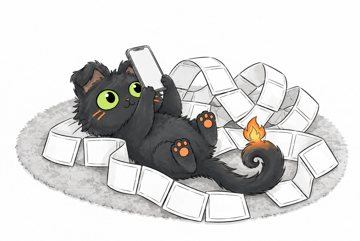 | [2026-10-27_gen_cx_gpt-image-2_00c70140.png](originals/2026-10-27_gen_cx_gpt-image-2_00c70140.png) 1531×1027, 2026-10-27 | scripts/frame_generator.py videos/L01_potom --only | Reference images 1-2 show only the drawing style: take from them the line work, colors, shading and simplicity, never their content or characters. Reference image 3 is the main character: keep exactly its head, face, col… |
| 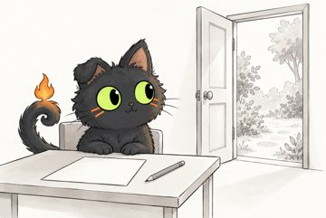 | [2026-10-27_gen_cx_gpt-image-2_02e06ff8.png](originals/2026-10-27_gen_cx_gpt-image-2_02e06ff8.png) 1531×1027, 2026-10-27 | scripts/frame_generator.py videos/L01_potom --only | Reference images 1-2 show only the drawing style: take from them the line work, colors, shading and simplicity, never their content or characters. Reference image 3 is the main character: keep exactly its head, face, col… |
|  | [2026-10-27_gen_cx_gpt-image-2_06cd8dc6.png](originals/2026-10-27_gen_cx_gpt-image-2_06cd8dc6.png) 1774×887, 2026-10-27 | scripts/frame_generator.py videos/L01_potom --only | Reference images 1-2 show only the drawing style: take from them the line work, colors, shading and simplicity, never their content or characters. Reference image 3 is the main character: keep exactly its head, face, col… |
| 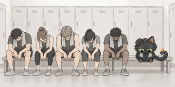 | [2026-10-27_gen_cx_gpt-image-2_130b28c0.png](originals/2026-10-27_gen_cx_gpt-image-2_130b28c0.png) 1774×887, 2026-10-27 | scripts/frame_generator.py videos/L01_potom --only | Reference images 1-2 show only the drawing style: take from them the line work, colors, shading and simplicity, never their content or characters. Reference image 3 is the main character: keep exactly its head, face, col… |
| 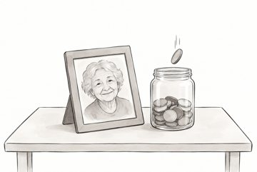 | [2026-10-27_gen_cx_gpt-image-2_1725045d.png](originals/2026-10-27_gen_cx_gpt-image-2_1725045d.png) 1531×1027, 2026-10-27 | scripts/frame_generator.py videos/L01_potom --only | Reference images 1-2 show only the drawing style: take from them the line work, colors, shading and simplicity, never their content or characters. SCENE: close-up on a desk with plain light background: a framed photograp… |
| 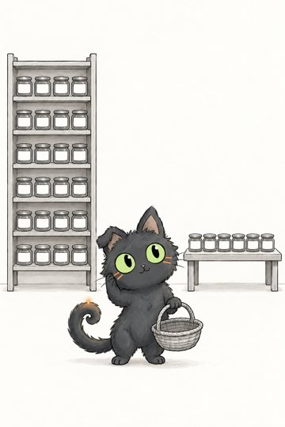 | [2026-10-27_gen_cx_gpt-image-2_1bab6dc2.png](originals/2026-10-27_gen_cx_gpt-image-2_1bab6dc2.png) 1024×1536, 2026-10-27 | `videos/11_vybor/reel/gen/v2_jars.png (удалён из репозитория)` | Reference images 1-3 show only the drawing style: take from them the line work, colors, shading and simplicity, never their content or characters. Reference image 4 is the main character: keep exactly its head, face, col… |
| 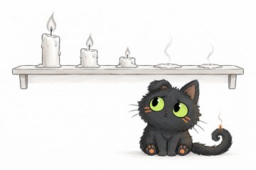 | [2026-10-27_gen_cx_gpt-image-2_21f374f2.png](originals/2026-10-27_gen_cx_gpt-image-2_21f374f2.png) 1536×1024, 2026-10-27 | scripts/frame_generator.py videos/L01_potom --only | Reference images 1-2 show only the drawing style: take from them the line work, colors, shading and simplicity, never their content or characters. Reference image 3 is the main character: keep exactly its head, face, col… |
| 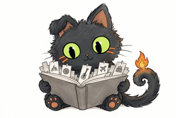 | [2026-10-27_gen_cx_gpt-image-2_28a27cda.png](originals/2026-10-27_gen_cx_gpt-image-2_28a27cda.png) 1531×1027, 2026-10-27 | scripts/frame_generator.py videos/L01_potom --only | Reference images 1-2 show only the drawing style: take from them the line work, colors, shading and simplicity, never their content or characters. Reference image 3 is the main character: keep exactly its head, face, col… |
| 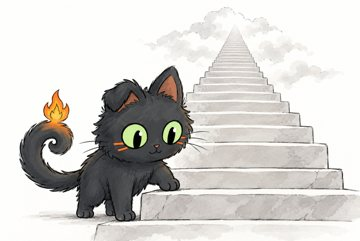 | [2026-10-27_gen_cx_gpt-image-2_2c7bd8ff.png](originals/2026-10-27_gen_cx_gpt-image-2_2c7bd8ff.png) 1531×1027, 2026-10-27 | scripts/frame_generator.py videos/L01_potom --only | Reference images 1-2 show only the drawing style: take from them the line work, colors, shading and simplicity, never their content or characters. Reference image 3 is the main character: keep exactly its head, face, col… |
| 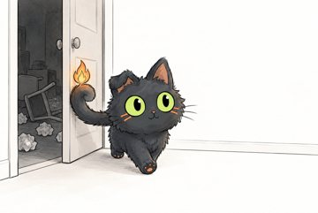 | [2026-10-27_gen_cx_gpt-image-2_2dfae49e.png](originals/2026-10-27_gen_cx_gpt-image-2_2dfae49e.png) 1531×1027, 2026-10-27 | scripts/frame_generator.py videos/L01_potom --only | Reference images 1-2 show only the drawing style: take from them the line work, colors, shading and simplicity, never their content or characters. Reference image 3 is the main character: keep exactly its head, face, col… |
| 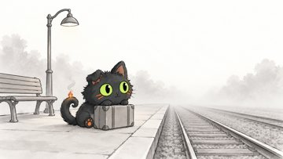 | [2026-10-27_gen_cx_gpt-image-2_34468923.png](originals/2026-10-27_gen_cx_gpt-image-2_34468923.png) 1672×941, 2026-10-27 | `videos/L01_potom/frames/033.png` | Reference images 1-2 show only the drawing style: take from them the line work, colors, shading and simplicity, never their content or characters. Reference image 3 is the main character: keep exactly its head, face, col… |
|  | [2026-10-27_gen_cx_gpt-image-2_34a1bd15.png](originals/2026-10-27_gen_cx_gpt-image-2_34a1bd15.png) 1531×1027, 2026-10-27 | scripts/frame_generator.py videos/L01_potom --only | Reference images 1-2 show only the drawing style: take from them the line work, colors, shading and simplicity, never their content or characters. Reference image 3 is the main character: keep exactly its head, face, col… |
| 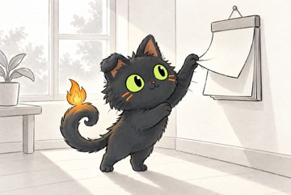 | [2026-10-27_gen_cx_gpt-image-2_38ee7f35.png](originals/2026-10-27_gen_cx_gpt-image-2_38ee7f35.png) 1531×1027, 2026-10-27 | scripts/frame_generator.py videos/L01_potom --only | Reference images 1-2 show only the drawing style: take from them the line work, colors, shading and simplicity, never their content or characters. Reference image 3 is the main character: keep exactly its head, face, col… |
| 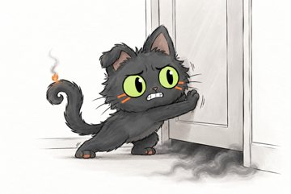 | [2026-10-27_gen_cx_gpt-image-2_391c1f59.png](originals/2026-10-27_gen_cx_gpt-image-2_391c1f59.png) 1531×1027, 2026-10-27 | scripts/frame_generator.py videos/L01_potom --only | Reference images 1-2 show only the drawing style: take from them the line work, colors, shading and simplicity, never their content or characters. Reference image 3 is the main character: keep exactly its head, face, col… |
| 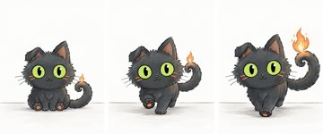 | [2026-10-27_gen_cx_gpt-image-2_3fbf9a9f.png](originals/2026-10-27_gen_cx_gpt-image-2_3fbf9a9f.png) 1942×809, 2026-10-27 | scripts/frame_generator.py videos/L01_potom --only | Reference images 1-2 show only the drawing style: take from them the line work, colors, shading and simplicity, never their content or characters. Reference image 3 is the main character: keep exactly its head, face, col… |
| 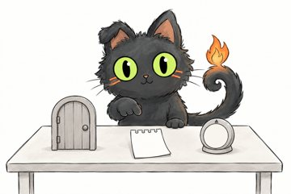 | [2026-10-27_gen_cx_gpt-image-2_46d58546.png](originals/2026-10-27_gen_cx_gpt-image-2_46d58546.png) 1531×1027, 2026-10-27 | scripts/frame_generator.py videos/L01_potom --only | Reference images 1-2 show only the drawing style: take from them the line work, colors, shading and simplicity, never their content or characters. Reference image 3 is the main character: keep exactly its head, face, col… |
| 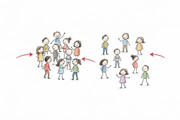 | [2026-10-27_gen_cx_gpt-image-2_4d296d59.png](originals/2026-10-27_gen_cx_gpt-image-2_4d296d59.png) 1531×1027, 2026-10-27 | scripts/frame_generator.py videos/L01_potom --only | Reference images 1-2 show only the drawing style: take from them the line work, colors, shading and simplicity, never their content or characters. SCENE: a hand-drawn diagram: on the left a dense cluster of twelve small … |
| 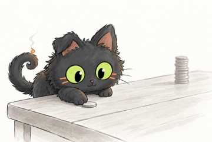 | [2026-10-27_gen_cx_gpt-image-2_53e34707.png](originals/2026-10-27_gen_cx_gpt-image-2_53e34707.png) 1531×1027, 2026-10-27 | scripts/frame_generator.py videos/L01_potom --only | Reference images 1-2 show only the drawing style: take from them the line work, colors, shading and simplicity, never their content or characters. Reference image 3 is the main character: keep exactly its head, face, col… |
| 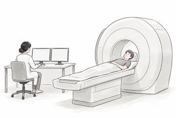 | [2026-10-27_gen_cx_gpt-image-2_57eefaa0.png](originals/2026-10-27_gen_cx_gpt-image-2_57eefaa0.png) 1531×1027, 2026-10-27 | scripts/frame_generator.py videos/L01_potom --only | Reference images 1-2 show only the drawing style: take from them the line work, colors, shading and simplicity, never their content or characters. SCENE: wide shot of a clean bright lab: a young adult student in a plain … |
| 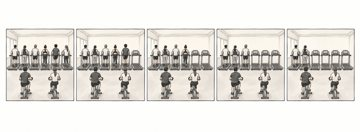 | [2026-10-27_gen_cx_gpt-image-2_6143dac1.png](originals/2026-10-27_gen_cx_gpt-image-2_6143dac1.png) 2073×758, 2026-10-27 | `videos/L01_potom/frames/013.png` | Reference images 1-2 show only the drawing style: take from them the line work, colors, shading and simplicity, never their content or characters. SCENE: a wide hand-drawn strip of five equal square panels in a row, sepa… |
| 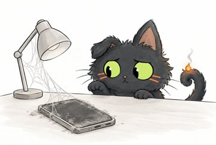 | [2026-10-27_gen_cx_gpt-image-2_6c7866b0.png](originals/2026-10-27_gen_cx_gpt-image-2_6c7866b0.png) 1531×1027, 2026-10-27 | scripts/frame_generator.py videos/L01_potom --only | Reference images 1-2 show only the drawing style: take from them the line work, colors, shading and simplicity, never their content or characters. Reference image 3 is the main character: keep exactly its head, face, col… |
|  | [2026-10-27_gen_cx_gpt-image-2_70857920.png](originals/2026-10-27_gen_cx_gpt-image-2_70857920.png) 1531×1027, 2026-10-27 | scripts/frame_generator.py videos/L01_potom --only | Reference images 1-2 show only the drawing style: take from them the line work, colors, shading and simplicity, never their content or characters. Reference image 3 is the main character: keep exactly its head, face, col… |
|  | [2026-10-27_gen_cx_gpt-image-2_71aaa991.png](originals/2026-10-27_gen_cx_gpt-image-2_71aaa991.png) 1531×1027, 2026-10-27 | scripts/frame_generator.py videos/L01_potom --only | Reference images 1-2 show only the drawing style: take from them the line work, colors, shading and simplicity, never their content or characters. Reference image 3 is the main character: keep exactly its head, face, col… |
| 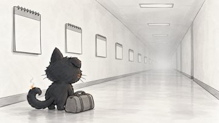 | [2026-10-27_gen_cx_gpt-image-2_757fcdb3.png](originals/2026-10-27_gen_cx_gpt-image-2_757fcdb3.png) 1672×941, 2026-10-27 | scripts/frame_generator.py videos/L01_potom --only | Reference images 1-2 show only the drawing style: take from them the line work, colors, shading and simplicity, never their content or characters. Reference image 3 is the main character: keep exactly its head, face, col… |
| 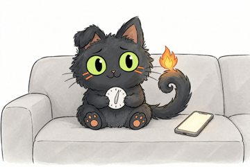 | [2026-10-27_gen_cx_gpt-image-2_79733435.png](originals/2026-10-27_gen_cx_gpt-image-2_79733435.png) 1531×1027, 2026-10-27 | scripts/frame_generator.py videos/L01_potom --only | Reference images 1-2 show only the drawing style: take from them the line work, colors, shading and simplicity, never their content or characters. Reference image 3 is the main character: keep exactly its head, face, col… |
| 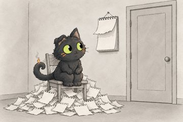 | [2026-10-27_gen_cx_gpt-image-2_8319c7a6.png](originals/2026-10-27_gen_cx_gpt-image-2_8319c7a6.png) 1531×1027, 2026-10-27 | scripts/frame_generator.py videos/L01_potom --only | Reference images 1-2 show only the drawing style: take from them the line work, colors, shading and simplicity, never their content or characters. Reference image 3 is the main character: keep exactly its head, face, col… |
| 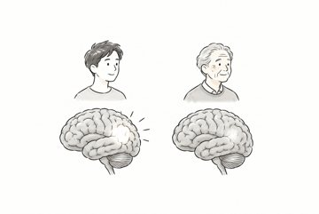 | [2026-10-27_gen_cx_gpt-image-2_84b22498.png](originals/2026-10-27_gen_cx_gpt-image-2_84b22498.png) 1531×1027, 2026-10-27 | scripts/frame_generator.py videos/L01_potom --only | Reference images 1-2 show only the drawing style: take from them the line work, colors, shading and simplicity, never their content or characters. SCENE: two brains side by side in the middle of a plain light background,… |
| 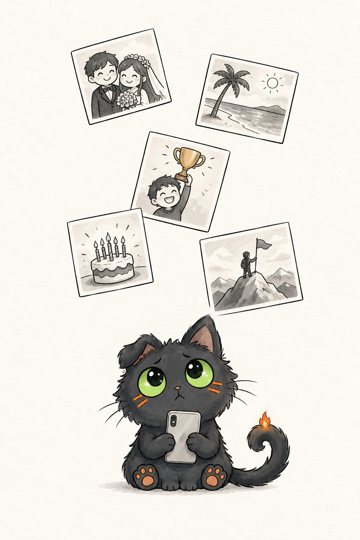 | [2026-10-27_gen_cx_gpt-image-2_95cfbf7f.png](originals/2026-10-27_gen_cx_gpt-image-2_95cfbf7f.png) 1024×1536, 2026-10-27 | `videos/12_lenta/reel/gen/l1_feed.png (удалён из репозитория)` | Reference images 1-3 show only the drawing style: take from them the line work, colors, shading and simplicity, never their content or characters. Reference image 4 is the main character: keep exactly its head, face, col… |
|  | [2026-10-27_gen_cx_gpt-image-2_9b2be98c.png](originals/2026-10-27_gen_cx_gpt-image-2_9b2be98c.png) 1531×1027, 2026-10-27 | scripts/frame_generator.py videos/L01_potom --only | Reference images 1-2 show only the drawing style: take from them the line work, colors, shading and simplicity, never their content or characters. Reference image 3 is the main character: keep exactly its head, face, col… |
| 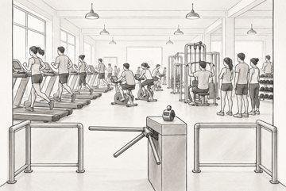 | [2026-10-27_gen_cx_gpt-image-2_9c02ddf3.png](originals/2026-10-27_gen_cx_gpt-image-2_9c02ddf3.png) 1531×1027, 2026-10-27 | scripts/frame_generator.py videos/L01_potom --only | Reference images 1-2 show only the drawing style: take from them the line work, colors, shading and simplicity, never their content or characters. SCENE: wide shot of the entrance of a busy university gym on a Monday mor… |
| 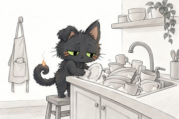 | [2026-10-27_gen_cx_gpt-image-2_9fbe067c.png](originals/2026-10-27_gen_cx_gpt-image-2_9fbe067c.png) 1531×1027, 2026-10-27 | scripts/frame_generator.py videos/L01_potom --only | Reference images 1-2 show only the drawing style: take from them the line work, colors, shading and simplicity, never their content or characters. Reference image 3 is the main character: keep exactly its head, face, col… |
|  | [2026-10-27_gen_cx_gpt-image-2_a4bc168b.png](originals/2026-10-27_gen_cx_gpt-image-2_a4bc168b.png) 1531×1027, 2026-10-27 | scripts/frame_generator.py videos/L01_potom --only | Reference images 1-2 show only the drawing style: take from them the line work, colors, shading and simplicity, never their content or characters. Reference image 3 is the main character: keep exactly its head, face, col… |
|  | [2026-10-27_gen_cx_gpt-image-2_a766fbb0.png](originals/2026-10-27_gen_cx_gpt-image-2_a766fbb0.png) 1531×1027, 2026-10-27 | scripts/frame_generator.py videos/L01_potom --only | Reference images 1-2 show only the drawing style: take from them the line work, colors, shading and simplicity, never their content or characters. Reference image 3 is the main character: keep exactly its head, face, col… |
| 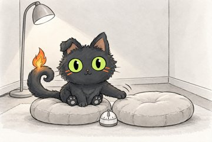 | [2026-10-27_gen_cx_gpt-image-2_aa72005b.png](originals/2026-10-27_gen_cx_gpt-image-2_aa72005b.png) 1531×1027, 2026-10-27 | scripts/frame_generator.py videos/L01_potom --only | Reference images 1-2 show only the drawing style: take from them the line work, colors, shading and simplicity, never their content or characters. Reference image 3 is the main character: keep exactly its head, face, col… |
| 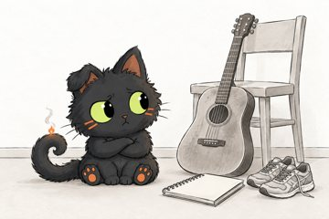 | [2026-10-27_gen_cx_gpt-image-2_aac5ac83.png](originals/2026-10-27_gen_cx_gpt-image-2_aac5ac83.png) 1536×1024, 2026-10-27 | scripts/frame_generator.py videos/L01_potom --only | Reference images 1-2 show only the drawing style: take from them the line work, colors, shading and simplicity, never their content or characters. Reference image 3 is the main character: keep exactly its head, face, col… |
| 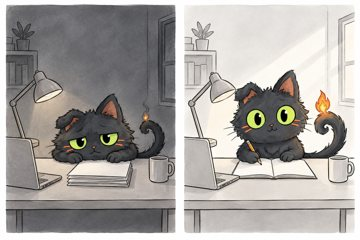 | [2026-10-27_gen_cx_gpt-image-2_b47ad6d7.png](originals/2026-10-27_gen_cx_gpt-image-2_b47ad6d7.png) 1536×1024, 2026-10-27 | scripts/frame_generator.py videos/L01_potom --only | Reference images 1-2 show only the drawing style: take from them the line work, colors, shading and simplicity, never their content or characters. Reference image 3 is the main character: keep exactly its head, face, col… |
| 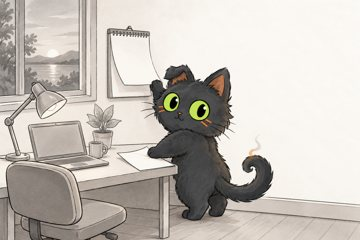 | [2026-10-27_gen_cx_gpt-image-2_bb675af3.png](originals/2026-10-27_gen_cx_gpt-image-2_bb675af3.png) 1536×1024, 2026-10-27 | scripts/frame_generator.py videos/L01_potom --only | Reference images 1-2 show only the drawing style: take from them the line work, colors, shading and simplicity, never their content or characters. Reference image 3 is the main character: keep exactly its head, face, col… |
|  | [2026-10-27_gen_cx_gpt-image-2_bb87085a.png](originals/2026-10-27_gen_cx_gpt-image-2_bb87085a.png) 1531×1027, 2026-10-27 | scripts/frame_generator.py videos/L01_potom --only | Reference images 1-2 show only the drawing style: take from them the line work, colors, shading and simplicity, never their content or characters. Reference image 3 is the main character: keep exactly its head, face, col… |
| 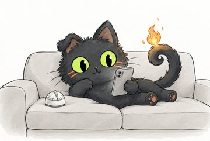 | [2026-10-27_gen_cx_gpt-image-2_bfd71c98.png](originals/2026-10-27_gen_cx_gpt-image-2_bfd71c98.png) 1531×1027, 2026-10-27 | scripts/frame_generator.py videos/L01_potom --only | Reference images 1-2 show only the drawing style: take from them the line work, colors, shading and simplicity, never their content or characters. Reference image 3 is the main character: keep exactly its head, face, col… |
| 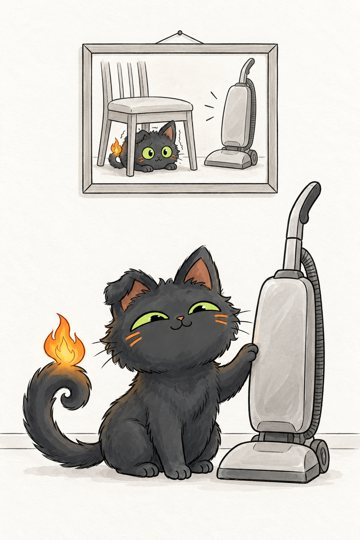 | [2026-10-27_gen_cx_gpt-image-2_d1f36dc5.png](originals/2026-10-27_gen_cx_gpt-image-2_d1f36dc5.png) 1024×1536, 2026-10-27 | `videos/12_lenta/reel/gen/l2_vacuum.png (удалён из репозитория)` | Reference images 1-3 show only the drawing style: take from them the line work, colors, shading and simplicity, never their content or characters. Reference image 4 is the main character: keep exactly its head, face, col… |
| 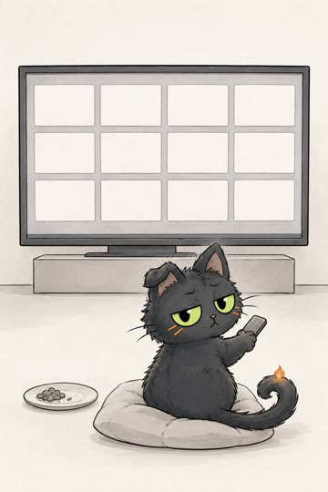 | [2026-10-27_gen_cx_gpt-image-2_e7c58406.png](originals/2026-10-27_gen_cx_gpt-image-2_e7c58406.png) 1024×1536, 2026-10-27 | `videos/11_vybor/reel/gen/v1_tv.png (удалён из репозитория)` | Reference images 1-3 show only the drawing style: take from them the line work, colors, shading and simplicity, never their content or characters. Reference image 4 is the main character: keep exactly its head, face, col… |
| 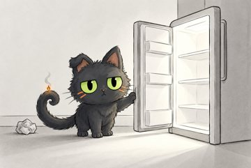 | [2026-10-27_gen_cx_gpt-image-2_eb2640c6.png](originals/2026-10-27_gen_cx_gpt-image-2_eb2640c6.png) 1531×1027, 2026-10-27 | scripts/frame_generator.py videos/L01_potom --only | Reference images 1-2 show only the drawing style: take from them the line work, colors, shading and simplicity, never their content or characters. Reference image 3 is the main character: keep exactly its head, face, col… |
| 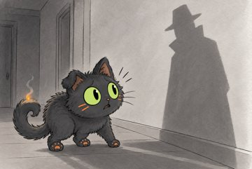 | [2026-10-27_gen_cx_gpt-image-2_f5f85512.png](originals/2026-10-27_gen_cx_gpt-image-2_f5f85512.png) 1531×1027, 2026-10-27 | scripts/frame_generator.py videos/L01_potom --only | Reference images 1-2 show only the drawing style: take from them the line work, colors, shading and simplicity, never their content or characters. Reference image 3 is the main character: keep exactly its head, face, col… |
| 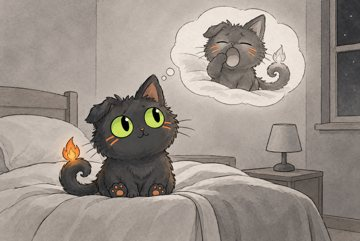 | [2026-10-27_gen_cx_gpt-image-2_fa90b035.png](originals/2026-10-27_gen_cx_gpt-image-2_fa90b035.png) 1531×1027, 2026-10-27 | scripts/frame_generator.py videos/L01_potom --only | Reference images 1-2 show only the drawing style: take from them the line work, colors, shading and simplicity, never their content or characters. Reference image 3 is the main character: keep exactly its head, face, col… |
| 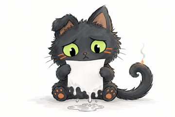 | [2026-10-27_gen_cx_gpt-image-2_fb58bf98.png](originals/2026-10-27_gen_cx_gpt-image-2_fb58bf98.png) 1531×1027, 2026-10-27 | scripts/frame_generator.py videos/L01_potom --only | Reference images 1-2 show only the drawing style: take from them the line work, colors, shading and simplicity, never their content or characters. Reference image 3 is the main character: keep exactly its head, face, col… |
| 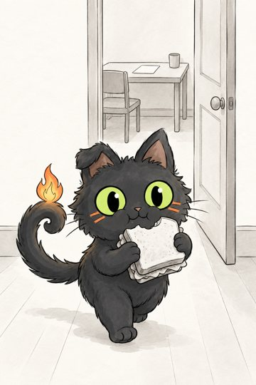 | [2026-10-28_gen_cx_gpt-image-2_3310b98f.png](originals/2026-10-28_gen_cx_gpt-image-2_3310b98f.png) 1024×1536, 2026-10-28 | scripts/reel_draw.py videos/13_dver/reel | Reference images 1-3 show only the drawing style: take from them the line work, colors, shading and simplicity, never their content or characters. Reference image 4 is the main character: keep exactly its head, face, col… |
| 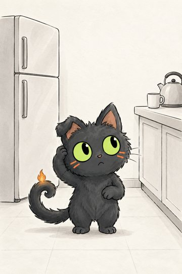 | [2026-10-28_gen_cx_gpt-image-2_39581659.png](originals/2026-10-28_gen_cx_gpt-image-2_39581659.png) 1024×1536, 2026-10-28 | scripts/reel_draw.py videos/13_dver/reel | Reference images 1-3 show only the drawing style: take from them the line work, colors, shading and simplicity, never their content or characters. Reference image 4 is the main character: keep exactly its head, face, col… |
| 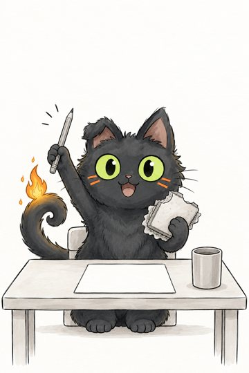 | [2026-10-28_gen_cx_gpt-image-2_70875f79.png](originals/2026-10-28_gen_cx_gpt-image-2_70875f79.png) 1024×1536, 2026-10-28 | scripts/reel_draw.py videos/13_dver/reel | Reference images 1-3 show only the drawing style: take from them the line work, colors, shading and simplicity, never their content or characters. Reference image 4 is the main character: keep exactly its head, face, col… |
| 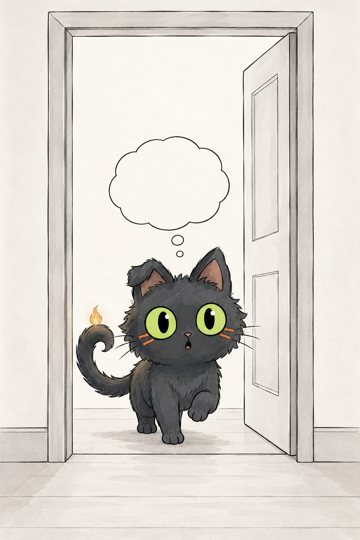 | [2026-10-28_gen_cx_gpt-image-2_a25265fc.png](originals/2026-10-28_gen_cx_gpt-image-2_a25265fc.png) 1024×1536, 2026-10-28 | scripts/reel_draw.py videos/13_dver/reel | Reference images 1-3 show only the drawing style: take from them the line work, colors, shading and simplicity, never their content or characters. Reference image 4 is the main character: keep exactly its head, face, col… |
| 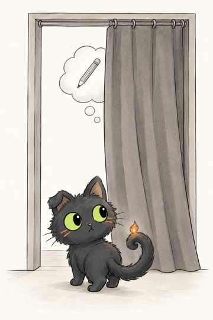 | [2026-10-28_gen_cx_gpt-image-2_aaaaa171.png](originals/2026-10-28_gen_cx_gpt-image-2_aaaaa171.png) 1024×1536, 2026-10-28 | scripts/reel_draw.py videos/13_dver/reel | Reference images 1-3 show only the drawing style: take from them the line work, colors, shading and simplicity, never their content or characters. Reference image 4 is the main character: keep exactly its head, face, col… |
| 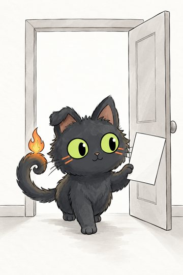 | [2026-10-28_gen_cx_gpt-image-2_cfb18a98.png](originals/2026-10-28_gen_cx_gpt-image-2_cfb18a98.png) 1024×1536, 2026-10-28 | scripts/reel_draw.py videos/13_dver/reel | Reference images 1-3 show only the drawing style: take from them the line work, colors, shading and simplicity, never their content or characters. Reference image 4 is the main character: keep exactly its head, face, col… |
| 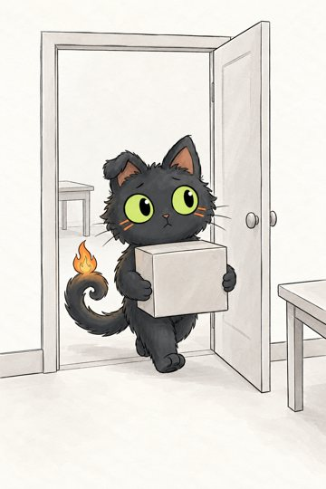 | [2026-10-28_gen_cx_gpt-image-2_f2214e26.png](originals/2026-10-28_gen_cx_gpt-image-2_f2214e26.png) 1024×1536, 2026-10-28 | scripts/reel_draw.py videos/13_dver/reel | Reference images 1-3 show only the drawing style: take from them the line work, colors, shading and simplicity, never their content or characters. Reference image 4 is the main character: keep exactly its head, face, col… |

## герой: состояние (3)

| превью | оригинал | где | промпт |
|---|---|---|---|
|  | [2026-10-21_look_states_hero-happy-tongue_bfcc03bb.png](originals/2026-10-21_look_states_hero-happy-tongue_bfcc03bb.png) 1270×938, 2026-10-21 | `look/states/hero-happy-tongue.png (удалён из репозитория)` |  |
|  | [2026-10-21_look_states_hero-neutral_cc2c8725.png](originals/2026-10-21_look_states_hero-neutral_cc2c8725.png) 890×685, 2026-10-21 | `look/states/hero-neutral.png` |  |
|  | [2026-10-21_look_states_hero-sleep-arcs_fa6294c3.png](originals/2026-10-21_look_states_hero-sleep-arcs_fa6294c3.png) 1293×965, 2026-10-21 | `look/states/hero-sleep-arcs.png` |  |

## герой: эталон (1)

| превью | оригинал | где | промпт |
|---|---|---|---|
|  | [2026-10-07_look_hero_95243e7a.png](originals/2026-10-07_look_hero_95243e7a.png) 1264×848, 2026-10-07 | `look/hero.png` |  |

## кадр эпизода (11)

| превью | оригинал | где | промпт |
|---|---|---|---|
|  | [2026-10-20_videos_01_sdvg_pismo_frames_001_bf2c59a4.png](originals/2026-10-20_videos_01_sdvg_pismo_frames_001_bf2c59a4.png) 1264×848, 2026-10-20 | `videos/01_sdvg_pismo/frames/001.png` | Reference images 1-2 show only the drawing style: take from them the line work, colors, shading and simplicity, never their content or characters. Reference image 3 is the main character: keep exactly its head, face, col… |
|  | [2026-10-20_videos_01_sdvg_pismo_frames_002_f1cbda02.png](originals/2026-10-20_videos_01_sdvg_pismo_frames_002_f1cbda02.png) 1264×848, 2026-10-20 | `videos/01_sdvg_pismo/frames/002.png` | medium shot: the main character stands holding its own head, a large brain drawn above it with a tiny glowing spark on one side and a massive dark boulder chained to the other side, the character straining under the weig… |
|  | [2026-10-20_videos_01_sdvg_pismo_frames_003_274b368a.png](originals/2026-10-20_videos_01_sdvg_pismo_frames_003_274b368a.png) 1264×848, 2026-10-20 | `videos/01_sdvg_pismo/frames/003.png` `videos/L01_potom/frames/041.png` | Reference images 1-2 show only the drawing style: take from them the line work, colors, shading and simplicity, never their content or characters. Reference image 3 is the main character: keep exactly its head, face, col… |
|  | [2026-10-20_videos_01_sdvg_pismo_frames_004_91a321a2.png](originals/2026-10-20_videos_01_sdvg_pismo_frames_004_91a321a2.png) 1264×848, 2026-10-20 | `videos/01_sdvg_pismo/frames/004.png` | Reference images 1-2 show only the drawing style: take from them the line work, colors, shading and simplicity, never their content or characters. Reference image 3 is the main character: keep exactly its head, face, col… |
|  | [2026-10-20_videos_01_sdvg_pismo_frames_005_8d288020.png](originals/2026-10-20_videos_01_sdvg_pismo_frames_005_8d288020.png) 1264×848, 2026-10-20 | `videos/01_sdvg_pismo/frames/005.png` `videos/L01_potom/frames/054.png` | Reference images 1-2 show only the drawing style: take from them the line work, colors, shading and simplicity, never their content or characters. Reference image 3 is the main character: keep exactly its head, face, col… |
|  | [2026-10-20_videos_02_sdvg_vremya_frames_001_f008509c.png](originals/2026-10-20_videos_02_sdvg_vremya_frames_001_f008509c.png) 1536×1024, 2026-10-20 | `videos/02_sdvg_vremya/frames/001.png` `videos/L01_potom/frames/020.png` | Reference images 1-2 show only the drawing style: take from them the line work, colors, shading and simplicity, never their content or characters. Reference image 3 is the main character: keep exactly its head, face, col… |
|  | [2026-10-20_videos_02_sdvg_vremya_frames_002_c465cc76.png](originals/2026-10-20_videos_02_sdvg_vremya_frames_002_c465cc76.png) 1914×822, 2026-10-20 | `videos/02_sdvg_vremya/frames/002.png` | Reference images 1-2 show only the drawing style: take from them the line work, colors, shading and simplicity, never their content or characters. SCENE: a hand-drawn horizontal line across the middle of the frame: a den… |
|  | [2026-10-20_videos_02_sdvg_vremya_frames_003_6235af10.png](originals/2026-10-20_videos_02_sdvg_vremya_frames_003_6235af10.png) 2057×765, 2026-10-20 | `videos/02_sdvg_vremya/frames/003.png` | Reference images 1-2 show only the drawing style: take from them the line work, colors, shading and simplicity, never their content or characters. Reference image 3 is the main character: keep exactly its head, face, col… |
|  | [2026-10-20_videos_02_sdvg_vremya_frames_004_f22b41a9.png](originals/2026-10-20_videos_02_sdvg_vremya_frames_004_f22b41a9.png) 1536×1024, 2026-10-20 | `videos/02_sdvg_vremya/frames/004.png` | Reference images 1-2 show only the drawing style: take from them the line work, colors, shading and simplicity, never their content or characters. Reference image 3 is the main character: keep exactly its head, face, col… |
|  | [2026-10-20_videos_02_sdvg_vremya_frames_005_c430181c.png](originals/2026-10-20_videos_02_sdvg_vremya_frames_005_c430181c.png) 1672×941, 2026-10-20 | `videos/02_sdvg_vremya/frames/005.png` `videos/L01_potom/frames/014.png` | Reference images 1-2 show only the drawing style: take from them the line work, colors, shading and simplicity, never their content or characters. Reference image 3 is the main character: keep exactly its head, face, col… |
| 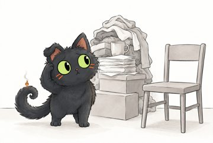 | [2026-10-27_videos_L01_potom_frames_021_9fe8c007.png](originals/2026-10-27_videos_L01_potom_frames_021_9fe8c007.png) 1531×1027, 2026-10-27 | `videos/L01_potom/frames/021.png` | Reference images 1-2 show only the drawing style: take from them the line work, colors, shading and simplicity, never their content or characters. Reference image 3 is the main character: keep exactly its head, face, col… |

## кукла: лицо (3)

| превью | оригинал | где | промпт |
|---|---|---|---|
|  | [2026-10-21_experiments_alive_cat_doll_faces_happy_src_3cc40e40.png](originals/2026-10-21_experiments_alive_cat_doll_faces_happy_src_3cc40e40.png) 1355×1017, 2026-10-21 | `experiments/alive_cat/doll/faces/happy_src.png` `/tmp/nap/design/mascot/png/happy-tongue.png` |  |
|  | [2026-10-21_experiments_alive_cat_doll_faces_happy_src_old_e6ba8d4a.png](originals/2026-10-21_experiments_alive_cat_doll_faces_happy_src_old_e6ba8d4a.png) 1531×1027, 2026-10-21 | `experiments/alive_cat/doll/faces/happy_src.png (прежняя версия)` |  |
|  | [2026-10-21_experiments_alive_cat_doll_faces_sleep_src_87a03f53.png](originals/2026-10-21_experiments_alive_cat_doll_faces_sleep_src_87a03f53.png) 1531×1027, 2026-10-21 | `experiments/alive_cat/doll/faces/sleep_src.png` |  |

## кукла: поза (9)

| превью | оригинал | где | промпт |
|---|---|---|---|
|  | [2026-10-07_experiments_alive_cat_doll_assets_hero_noleg_lef_fc77f652.png](originals/2026-10-07_experiments_alive_cat_doll_assets_hero_noleg_lef_fc77f652.png) 1264×848, 2026-10-07 | `experiments/alive_cat/doll/assets/hero_noleg_left.png` |  |
|  | [2026-10-07_experiments_alive_cat_doll_assets_hero_paw_up_4277766f.png](originals/2026-10-07_experiments_alive_cat_doll_assets_hero_paw_up_4277766f.png) 1264×848, 2026-10-07 | `experiments/alive_cat/doll/assets/hero_paw_up.png` `experiments/alive_cat/doll/beckon.png` |  |
|  | [2026-10-07_experiments_alive_cat_doll_assets_hero_point_rig_5b46e5f4.png](originals/2026-10-07_experiments_alive_cat_doll_assets_hero_point_rig_5b46e5f4.png) 1264×848, 2026-10-07 | `experiments/alive_cat/doll/assets/hero_point_right.png` `experiments/alive_cat/doll/point.png` |  |
|  | [2026-10-07_experiments_alive_cat_doll_assets_hero_reach_lef_0dc37440.png](originals/2026-10-07_experiments_alive_cat_doll_assets_hero_reach_lef_0dc37440.png) 1264×848, 2026-10-07 | `experiments/alive_cat/doll/assets/hero_reach_left_v3_fixed.png` |  |
|  | [2026-10-07_experiments_alive_cat_doll_assets_hero_reach_lef_963c87a0.png](originals/2026-10-07_experiments_alive_cat_doll_assets_hero_reach_lef_963c87a0.png) 1264×848, 2026-10-07 | `experiments/alive_cat/doll/assets/hero_reach_left.png` |  |
|  | [2026-10-07_experiments_alive_cat_doll_assets_hero_reach_lef_acc59d60.png](originals/2026-10-07_experiments_alive_cat_doll_assets_hero_reach_lef_acc59d60.png) 1264×848, 2026-10-07 | `experiments/alive_cat/doll/assets/hero_reach_left_v2.png` |  |
|  | [2026-10-07_experiments_alive_cat_doll_assets_hero_reach_lef_f362e617.png](originals/2026-10-07_experiments_alive_cat_doll_assets_hero_reach_lef_f362e617.png) 1264×848, 2026-10-07 | `experiments/alive_cat/doll/assets/hero_reach_left_v3.png` |  |
|  | [2026-10-07_experiments_alive_cat_doll_assets_hero_wave_9da89b40.png](originals/2026-10-07_experiments_alive_cat_doll_assets_hero_wave_9da89b40.png) 1264×848, 2026-10-07 | `experiments/alive_cat/doll/assets/hero_wave.png` |  |
|  | [2026-10-07_experiments_alive_cat_doll_assets_hero_wave_raw_e9e10a2d.png](originals/2026-10-07_experiments_alive_cat_doll_assets_hero_wave_raw_e9e10a2d.png) 1264×848, 2026-10-07 | `experiments/alive_cat/doll/assets/hero_wave_raw.png` |  |

## образец стиля (2)

| превью | оригинал | где | промпт |
|---|---|---|---|
|  | [2026-10-07_look_style_1_desk_1c1c5a17.jpg](originals/2026-10-07_look_style_1_desk_1c1c5a17.jpg) 1264×848, 2026-10-07 | `look/style/1_desk.png` |  |
|  | [2026-10-07_look_style_2_objects_3fa15648.jpg](originals/2026-10-07_look_style_2_objects_3fa15648.jpg) 1264×848, 2026-10-07 | `look/style/2_objects.png` |  |

## предмет (1)

| превью | оригинал | где | промпт |
|---|---|---|---|
|  | [2026-10-07_experiments_alive_cat_doll_assets_envelope_98b79707.png](originals/2026-10-07_experiments_alive_cat_doll_assets_envelope_98b79707.png) 304×107, 2026-10-07 | `experiments/alive_cat/doll/assets/envelope.png` |  |

## рисунок рилса (14)

| превью | оригинал | где | промпт |
|---|---|---|---|
|  | [2026-10-23_videos_01_sdvg_pismo_reel_gen_r2_hourglass_2b638ebd.png](originals/2026-10-23_videos_01_sdvg_pismo_reel_gen_r2_hourglass_2b638ebd.png) 1531×1027, 2026-10-23 | `videos/01_sdvg_pismo/reel/gen/r2_hourglass.png` `videos/L01_potom/frames/047.png` | Reference images 1-3 show only the drawing style: take from them the line work, colors, shading and simplicity, never their content or characters. Reference image 4 is the main character: keep exactly its head, face, col… |
|  | [2026-10-25_videos_03_lenivyi_reel_gen_g1_hands_cb7f8c5c.png](originals/2026-10-25_videos_03_lenivyi_reel_gen_g1_hands_cb7f8c5c.png) 1531×1027, 2026-10-25 | `videos/03_lenivyi/reel/gen/g1_hands.png` | Reference images 1-3 show only the drawing style: take from them the line work, colors, shading and simplicity, never their content or characters. Reference image 4 is the main character: keep exactly its head, face, col… |
|  | [2026-10-25_videos_03_lenivyi_reel_gen_g2_tail_62fcfcc3.png](originals/2026-10-25_videos_03_lenivyi_reel_gen_g2_tail_62fcfcc3.png) 1531×1027, 2026-10-25 | `videos/03_lenivyi/reel/gen/g2_tail.png` `videos/L01_potom/frames/038.png` | Reference images 1-3 show only the drawing style: take from them the line work, colors, shading and simplicity, never their content or characters. Reference image 4 is the main character: keep exactly its head, face, col… |
|  | [2026-10-25_videos_04_noch_reel_gen_n2_dawn_692a9d44.png](originals/2026-10-25_videos_04_noch_reel_gen_n2_dawn_692a9d44.png) 1531×1027, 2026-10-25 | `videos/04_noch/reel/gen/n2_dawn.png` | Reference images 1-3 show only the drawing style: take from them the line work, colors, shading and simplicity, never their content or characters. Reference image 4 is the main character: keep exactly its head, face, col… |
|  | [2026-10-25_videos_04_noch_reel_gen_n3_lamp_island_49e4bac4.png](originals/2026-10-25_videos_04_noch_reel_gen_n3_lamp_island_49e4bac4.png) 1531×1027, 2026-10-25 | `videos/04_noch/reel/gen/n3_lamp_island.png` | Reference images 1-3 show only the drawing style: take from them the line work, colors, shading and simplicity, never their content or characters. Reference image 4 is the main character: keep exactly its head, face, col… |
|  | [2026-10-25_videos_04_noch_reel_gen_n5_bed_side_bc498c2b.png](originals/2026-10-25_videos_04_noch_reel_gen_n5_bed_side_bc498c2b.png) 1531×1027, 2026-10-25 | `videos/04_noch/reel/gen/n5_bed_side.png` | Reference images 1-3 show only the drawing style: take from them the line work, colors, shading and simplicity, never their content or characters. Reference image 4 is the main character: keep exactly its head, face, col… |
|  | [2026-10-25_videos_05_ustal_reel_gen_u1_floor_9396085a.png](originals/2026-10-25_videos_05_ustal_reel_gen_u1_floor_9396085a.png) 1531×1027, 2026-10-25 | `videos/05_ustal/reel/gen/u1_floor.png` `videos/L01_potom/frames/037.png` | Reference images 1-3 show only the drawing style: take from them the line work, colors, shading and simplicity, never their content or characters. Reference image 4 is the main character: keep exactly its head, face, col… |
|  | [2026-10-25_videos_05_ustal_reel_gen_u2_glass_a5d52a39.png](originals/2026-10-25_videos_05_ustal_reel_gen_u2_glass_a5d52a39.png) 1254×1254, 2026-10-25 | `videos/05_ustal/reel/gen/u2_glass.png` | Reference images 1-3 show only the drawing style: take from them the line work, colors, shading and simplicity, never their content or characters. Reference image 4 is the main character: keep exactly its head, face, col… |
|  | [2026-10-25_videos_05_ustal_reel_gen_u3_glass_down_6d36416f.png](originals/2026-10-25_videos_05_ustal_reel_gen_u3_glass_down_6d36416f.png) 1536×1024, 2026-10-25 | `videos/05_ustal/reel/gen/u3_glass_down.png` | Reference images 1-3 show only the drawing style: take from them the line work, colors, shading and simplicity, never their content or characters. Reference image 4 is the main character: keep exactly its head, face, col… |
|  | [2026-10-25_videos_05_ustal_reel_gen_u3_glass_down_raw_dc2c616a.png](originals/2026-10-25_videos_05_ustal_reel_gen_u3_glass_down_raw_dc2c616a.png) 1536×1024, 2026-10-25 | `videos/05_ustal/reel/gen/u3_glass_down_raw.png` |  |
|  | [2026-10-23_videos_01_sdvg_pismo_reel_gen_r1_phone_e3b862b6.png](originals/2026-10-23_videos_01_sdvg_pismo_reel_gen_r1_phone_e3b862b6.png) 1531×1027, 2026-10-27 | `videos/01_sdvg_pismo/reel/gen/r1_phone.png` | Reference images 1-3 show only the drawing style: take from them the line work, colors, shading and simplicity, never their content or characters. Reference image 4 is the main character: keep exactly its head, face, col… |
|  | [2026-10-25_videos_04_noch_reel_gen_n1_bed_top_39ca987a.png](originals/2026-10-25_videos_04_noch_reel_gen_n1_bed_top_39ca987a.png) 1531×1027, 2026-10-27 | `videos/04_noch/reel/gen/n1_bed_top.png` | Reference images 1-3 show only the drawing style: take from them the line work, colors, shading and simplicity, never their content or characters. Reference image 4 is the main character: keep exactly its head, face, col… |
|  | [2026-10-25_videos_04_noch_reel_gen_n4_tea_day_40bdbf52.png](originals/2026-10-25_videos_04_noch_reel_gen_n4_tea_day_40bdbf52.png) 1254×1254, 2026-10-27 | `videos/04_noch/reel/gen/n4_tea_day.png` | Reference images 1-3 show only the drawing style: take from them the line work, colors, shading and simplicity, never their content or characters. Reference image 4 is the main character: keep exactly its head, face, col… |
| 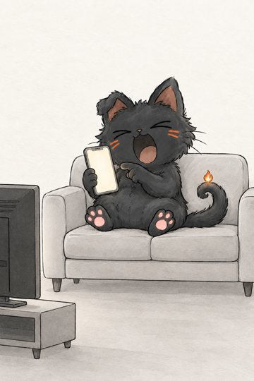 | [2026-10-26_videos_08_dvoinoy_reel_gen_q1_sofa_3bd96cbf.png](originals/2026-10-26_videos_08_dvoinoy_reel_gen_q1_sofa_3bd96cbf.png) 1024×1536, 2026-10-27 | `videos/08_dvoinoy/reel/gen/q1_sofa.png` | Reference images 1-3 show only the drawing style: take from them the line work, colors, shading and simplicity, never their content or characters. Reference image 4 is the main character: keep exactly its head, face, col… |

## эталон сайта (2)

| превью | оригинал | где | промпт |
|---|---|---|---|
|  | [2026-10-25_neutral_2fe4c340.png](originals/2026-10-25_neutral_2fe4c340.png) 1347×987, 2026-10-25 | `/tmp/nap/design/mascot/png/neutral.png` |  |
|  | [2026-10-25_sleep-arcs_394130b3.png](originals/2026-10-25_sleep-arcs_394130b3.png) 1098×877, 2026-10-25 | `/tmp/nap/design/mascot/png/sleep-arcs.png` |  |
